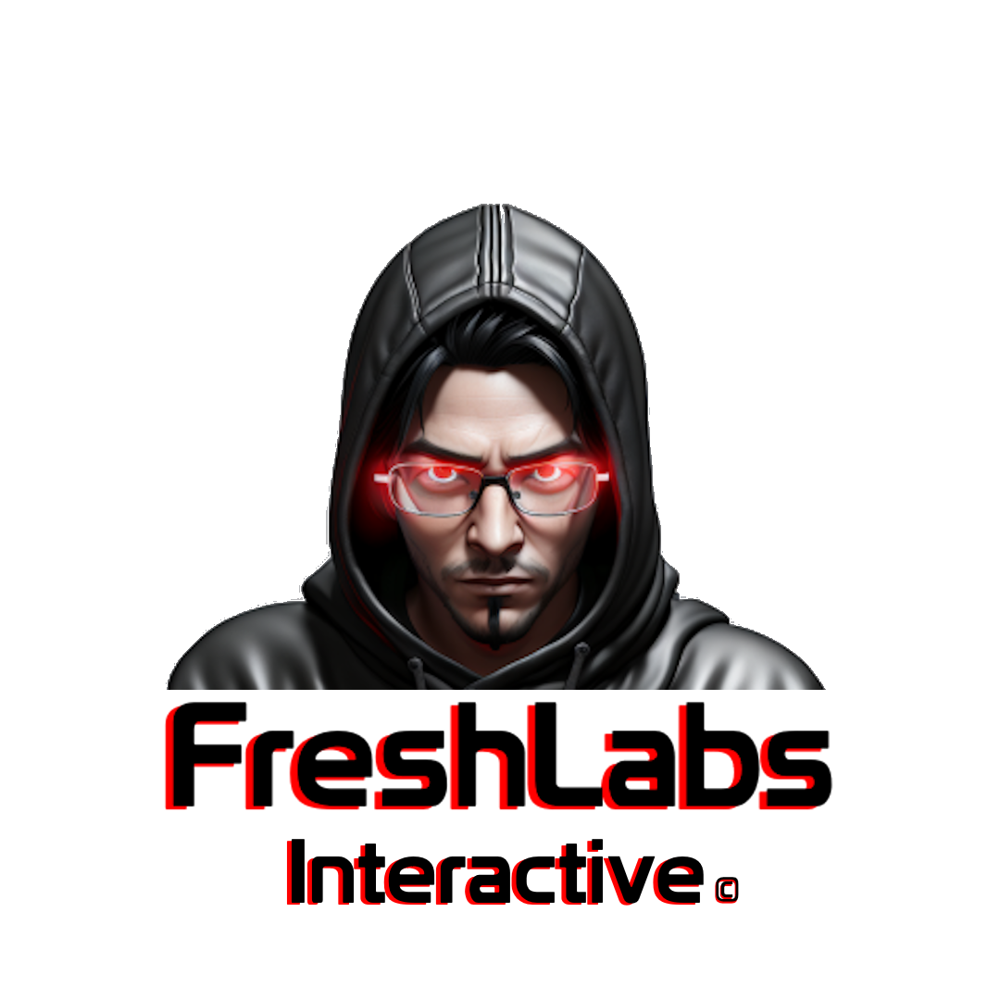

 

# BUILDING BEYOND THE ORDINARY.

**INDEPENDENT DEVELOPMENT • SOFTWARE ENGINEERING • HARDWARE INNOVATION**

---

### ` WHO WE ARE `

**WE CREATE. WE ENGINEER. WE INNOVATE.**

FreshLabs Interactive is an independent development studio dedicated to building custom software, interactive experiences, hardware solutions, and experimental technology.

Our work spans multiple areas of development, combining software engineering, game development, electronics, embedded systems, 3D modeling, and hardware modification.

From custom Unity development tools and desktop applications to ESP32-powered devices and Xbox 360 engineering, every project represents an opportunity to explore new ideas and build something useful.

We believe in understanding how technology works, pushing beyond its limitations, and creating our own solutions when existing ones aren't enough.

---

## `01` — DEVELOPMENT DIVISIONS

<table>
<tr>
<td width="50%" valign="top">

<h3>🎮 GAME DEVELOPMENT</h3>

Custom game development and tools built around Unity.

- Unity 6 / Unity 6.3
- Custom Unity Editor extensions
- C# gameplay systems
- URP shader development
- Character and hair systems
- Blender development tools
- Asset pipeline automation
- Game development utilities

</td>
<td width="50%" valign="top">

<h3>💻 SOFTWARE ENGINEERING</h3>

Custom applications and utilities designed to solve real problems.

- C# and .NET development
- WPF desktop applications
- .NET MAUI Android applications
- Windows utilities
- File management tools
- Developer productivity tools
- Automation systems
- Custom application interfaces

</td>
</tr>
<tr>
<td width="50%" valign="top">

<h3>🔌 ELECTRONICS & EMBEDDED SYSTEMS</h3>

Hardware projects combining electronics, firmware, and custom interfaces.

- ESP32 / ESP32-C3 / ESP32-S3
- Arduino / ATmega32U4
- Custom macropads and controllers
- OLED and TFT displays
- ESP-NOW wireless communication
- Bluetooth HID devices
- Sensor integration
- Custom firmware and electronics

</td>
<td width="50%" valign="top">

<h3>🛠️ CONSOLE MODDING & ENGINEERING</h3>

Hardware and software development for console customization and modification.

- Xbox 360 RGH / RGH3
- Custom diagnostic systems
- Sentry monitoring systems
- LED control systems
- Console utilities
- Hardware modifications
- Custom display interfaces
- Console automation and tools

</td>
</tr>
</table>

---

## `02` — FEATURED PROJECTS

A selection of projects from the FreshLabs Interactive development ecosystem.

<table>
<tr>
<td width="50%" valign="top">

<h3>🔔 XNotify Tweaks</h3>

Custom Xbox 360 notification functionality and console customization.

[VIEW PROJECT →](https://github.com/FreshLabs-Interactive/XNotify-Tweaks)

</td>
<td width="50%" valign="top">

<h3>💡 Lightshow v3</h3>

An Xbox 360 Ring of Light and power LED customization system featuring programmable lighting sequences and an onboard Studio.

[VIEW PROJECT →](https://github.com/FreshLabs-Interactive/Lightshow-v3)

</td>
</tr>
<tr>
<td width="50%" valign="top">

<h3>🖥️ xLume360 + Sentry Sync</h3>

An integration of xLume and Sentry Sync, bringing together custom console lighting and system monitoring.

[VIEW PROJECT →](https://github.com/FreshLabs-Interactive/xLume360-with-Sentry-Sync)

</td>
<td width="50%" valign="top">

<h3>🎞️ Xbox 360 WMV9 Creator</h3>

A custom video conversion utility for creating Xbox 360-compatible WMV9 files for fakeanim.xex.

[VIEW PROJECT →](https://github.com/FreshLabs-Interactive/Xbox-360-WMV9-Creator)

</td>
</tr>
</table>

---

## `03` — SOFTWARE & DEVELOPMENT TOOLS

Beyond our featured projects, FreshLabs develops a collection of tools and utilities designed to improve development workflows.

| Category | Technologies and Projects |
|:---|:---|
| Unity Development | Editor extensions, shaders, localization, automation |
| Desktop Software | WPF, .NET 8/9, C# |
| Mobile Development | .NET MAUI, Android |
| 3D Development | Blender, DAZ Studio, asset pipelines |
| Developer Tools | Git integration, file utilities, automation |
| Video & Media | Video conversion, hardware encoding, media utilities |
| Embedded Software | ESP32 firmware, Arduino, Bluetooth |

---

## `04` — TECHNOLOGY STACK

### PROGRAMMING LANGUAGES

### FRAMEWORKS & GAME DEVELOPMENT

### HARDWARE & EMBEDDED DEVELOPMENT

### DEVELOPMENT ENVIRONMENT

---

## `05` — ENGINEERING & EXPERIMENTATION

Not every project starts with an existing solution.

Some of our work involves exploring hardware limitations, reverse-engineering workflows, developing custom communication protocols, and building tools to bridge technologies that weren't originally designed to work together.

Areas of ongoing experimentation include:

- Embedded wireless communication
- Custom hardware interfaces
- Bluetooth and USB device development
- Console diagnostics and monitoring
- 3D asset processing and automation
- Custom software integrations
- Hardware and software interoperability

**The goal is simple: understand the technology, find the possibilities, and build the solution.**

---

## `06` — DEVELOPMENT PHILOSOPHY

### THINK DIFFERENTLY. BUILD INDEPENDENTLY.

| Principle | Description |
|:---|:---|
| INNOVATION | Explore ideas beyond conventional solutions. |
| ENGINEERING | Understand the systems behind the technology. |
| DEVELOPMENT | Turn concepts into functional projects. |
| EXPERIMENTATION | Test, modify, improve, and push boundaries. |
| OPEN DEVELOPMENT | Share projects, tools, and knowledge with the community. |

---

## `07` — EXPLORE FRESHLABS

<h3>HAVE A LOOK AROUND.</h3>

Discover our projects, explore our source code, and follow development.

 

# FRESHLABS INTERACTIVE

**BUILDING BEYOND THE ORDINARY.**

INDEPENDENT DEVELOPMENT • CREATIVE ENGINEERING • CONTINUOUS INNOVATION

